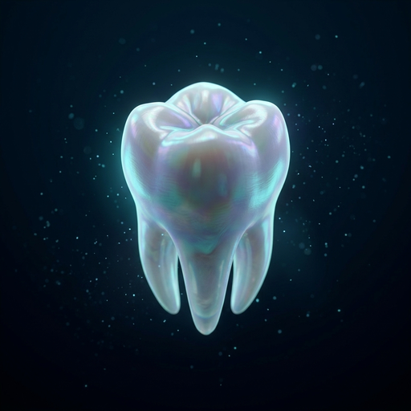

# 🦷 PERLNEST - Panoramic Dental X-Ray Analysis System

[](https://www.python.org/downloads/)
[](https://reactjs.org/)
[](https://github.com/ultralytics/ultralytics)
[](LICENSE)

**PERLNEST** (Panoramic Evaluation and Recognition using Learning for Neural-Enhanced Smart Teeth) is an AI-powered dental analysis system that uses deep learning to detect teeth, segment caries, and identify dental findings from panoramic X-ray images.



---

## 🌟 Features

### Three Specialized AI Models

- **Model 1: Tooth Detection & FDI Numbering**
  - Detects and classifies 32 individual teeth (FDI 11-48)
  - YOLOv8n object detection architecture
  - **Performance**: 97.9% mAP@50, 95.4% Precision, 95.0% Recall

- **Model 2: Caries Segmentation**
  - Identifies and segments dental caries regions
  - YOLOv8n-Seg instance segmentation
  - **Performance**: 99.3% mAP@50, 98.1% Precision, 99.4% Recall

- **Model 3: Dental Findings Segmentation**
  - Detects fillings, composite, amalgam, crowns, and implants
  - YOLOv8n-Seg instance segmentation (5 classes)
  - **Performance**: 66.0% mAP@50, 57.0% Precision, 72.0% Recall

### Intelligent Tooth-Wise Fusion
- Spatial overlap-based assignment of findings to specific teeth
- Deduplication and confidence-based selection
- Comprehensive tooth-wise findings table

### Modern Web Interface
- React + Vite frontend with Tailwind CSS
- Real-time dental X-ray analysis
- Interactive visualization with 3D effects
- Adjustable confidence thresholds
- Export results (CSV + annotated images)

---

## 🚀 Quick Start

### Prerequisites

- **Python**: 3.8 or higher
- **Node.js**: 16 or higher
- **Git**: For cloning the repository
- **GPU**: Optional but recommended (CUDA-compatible)

### Installation

#### 1. Clone the Repository
```bash
git clone https://github.com/PrajwalMudrabett/PearlNest_AI_Dental_Health_Care.git
cd PearlNest_AI_Dental_Health_Care
```

#### 2. Install Python Dependencies
```bash
pip install ultralytics flask flask-cors opencv-python numpy pandas pillow streamlit
```

Or use requirements file (if available):
```bash
pip install -r requirements.txt
```

#### 3. Install Frontend Dependencies
```bash
cd frontend
npm install
cd ..
```

#### 4. Download Trained Models
**Note**: Model weights are not included in this repository due to file size.

You need to either:
- **Option A**: Train the models yourself (see [Training Guide](#-training-models))
- **Option B**: Download pre-trained weights and place them in the correct directories:
  ```
  runs/detect/runs/detect/train-model1-retrained/weights/best.pt
  runs/segment/train-2/weights/best.pt
  runs/segment/runs/segment/model3-filling-segmentation/weights/best.pt
  ```

#### 5. Verify Setup
```bash
python verify_models.py
```

Expected output:
```
✓ Model 1 (Tooth Detection)
✓ Model 2 (Caries Segmentation)
✓ Model 3 (Findings Segmentation)
✓ All model files found and ready!
```

---

## 🎯 Running the Application

### Option 1: Web Application (Recommended)

#### Terminal 1 - Start Backend API
```bash
python backend/api.py
```

#### Terminal 2 - Start Frontend
```bash
cd frontend
npm run dev
```

Open browser to: **http://localhost:5173**

### Option 2: Streamlit Interface
```bash
streamlit run app.py
```

Open browser to: **http://localhost:8501**

---

## 📖 Usage

### Analyzing a Dental X-Ray

1. **Upload Image**
   - Click the upload area or drag & drop a panoramic X-ray
   - Supported formats: JPG, JPEG, PNG (max 20 MB)

2. **Configure Parameters** (Optional)
   - Model 1 Confidence: 0.25 (default)
   - Model 2 Confidence: 0.25 (default)
   - Model 3 Confidence: 0.50 (default)

3. **Run Analysis**
   - Click "Run Analysis" button
   - Processing takes 2-10 seconds

4. **View Results**
   - Annotated X-ray with detected teeth and findings
   - Summary metrics (teeth count, caries, fillings, etc.)
   - Tooth-wise findings table

5. **Export Results**
   - Download annotated X-ray (PNG)
   - Export tooth-wise findings (CSV)

---

## 🏗️ Project Structure

```
PearlNest_AI_Dental_Health_Care/
├── backend/
│   └── api.py                    # Flask REST API
├── frontend/
│   ├── src/
│   │   ├── components/           # React components
│   │   ├── App.jsx              # Main application
│   │   └── styles.css           # Tailwind styles
│   ├── public/                  # Static assets
│   └── package.json             # Frontend dependencies
├── runs/                        # Model weights (not in repo)
│   ├── detect/                  # Model 1 weights
│   └── segment/                 # Model 2 & 3 weights
├── app.py                       # Streamlit interface
├── perlnest_pipeline.py         # Core analysis pipeline
├── train_model1.py              # Model 1 training script
├── train_model3.py              # Model 3 training script
├── train_model3_improved.py     # Enhanced Model 3 training
├── verify_models.py             # Model path verification
├── .gitignore                   # Git ignore configuration
└── README.md                    # This file
```

---

## 🧠 Training Models

### Model 1: Tooth Detection

```bash
# Check dataset
python train_model1.py check

# Train model
python train_model1.py train --epochs 100 --batch 16

# Validate
python train_model1.py validate
```

### Model 2: Caries Segmentation
*Training script similar to Model 1 (not included in initial commit)*

### Model 3: Dental Findings

```bash
# Basic training
python train_model3.py train --epochs 100 --batch 8

# Improved training (better accuracy)
python train_model3_improved.py train --yolo-base yolov8m-seg.pt --preprocess clahe
```

**For detailed training instructions, see**:
- `IMPROVE_MODEL3_ACCURACY.md` - Strategies to improve Model 3
- `QUICK_START_IMPROVEMENTS.md` - Quick wins for better accuracy
- `training_guide.md` - General training guide

---

## 📊 Model Performance

| Model | Task | Test Images | mAP@50 | mAP@50-95 | Precision | Recall |
|-------|------|-------------|---------|-----------|-----------|---------|
| **Model 1** | Tooth Detection (32 classes) | 28 | 97.9% | 67.2% | 95.4% | 95.0% |
| **Model 2** | Caries Segmentation (1 class) | 53 | 99.3% | 70.5% | 98.1% | 99.4% |
| **Model 3** | Findings Segmentation (5 classes) | 130 | 66.0% | 45.0% | 57.0% | 72.0% |

**Note**: Model 3 has room for improvement. See improvement guides for strategies to boost accuracy by 20-30%.

---

## 🔧 Configuration

### Model Paths

Edit `perlnest_pipeline.py` to configure model paths:

```python
MODEL1_PATH = r"runs\detect\runs\detect\train-model1-retrained\weights\best.pt"
MODEL2_PATH = r"runs\segment\train-2\weights\best.pt"
MODEL3_PATH = r"runs\segment\runs\segment\model3-filling-segmentation\weights\best.pt"
```

### API Configuration

Edit `backend/api.py` for API settings:

```python
app.config["MAX_CONTENT_LENGTH"] = 20 * 1024 * 1024  # 20 MB upload limit
CORS(app, resources={r"/api/*": {"origins": ["http://localhost:5173"]}})
```

---

## 🎨 Frontend Development

```bash
cd frontend

# Development server with hot reload
npm run dev

# Build for production
npm run build

# Preview production build
npm run preview
```

---

## 📚 Documentation

- **[START_APPLICATION.md](START_APPLICATION.md)** - Comprehensive startup guide
- **[MODEL_PATHS_UPDATED.md](MODEL_PATHS_UPDATED.md)** - Model configuration details
- **[IMPROVE_MODEL3_ACCURACY.md](IMPROVE_MODEL3_ACCURACY.md)** - Model 3 improvement strategies
- **[QUICK_START_IMPROVEMENTS.md](QUICK_START_IMPROVEMENTS.md)** - Quick improvement guide
- **[PROJECT_HANDOFF_v1.md](PROJECT_HANDOFF_v1.md)** - Project handoff documentation

---

## 🧪 Testing

### Verify Models
```bash
python verify_models.py
```

### Test Backend API
```bash
# Start backend
python backend/api.py

# In another terminal, test health endpoint
curl http://127.0.0.1:5000/api/health
```

### Test Complete Pipeline
```bash
python test_all_models.py
```

---

## 🐛 Troubleshooting

### Models Not Loading
```bash
# Verify paths
python verify_models.py

# Check if ultralytics is installed
pip install ultralytics
```

### Frontend Build Issues
```bash
cd frontend
rm -rf node_modules package-lock.json
npm install
npm run dev
```

### API Connection Issues
- Ensure backend is running on port 5000
- Check firewall settings
- Verify CORS configuration in `backend/api.py`

### For more troubleshooting, see: [START_APPLICATION.md](START_APPLICATION.md)

---

## 🤝 Contributing

This is a research project. Contributions are welcome!

1. Fork the repository
2. Create a feature branch (`git checkout -b feature/AmazingFeature`)
3. Commit your changes (`git commit -m 'Add some AmazingFeature'`)
4. Push to the branch (`git push origin feature/AmazingFeature`)
5. Open a Pull Request

---

## ⚠️ Disclaimer

**IMPORTANT**: PERLNEST is a research and educational prototype developed for academic purposes.

- ❌ **Not for clinical use** or diagnosis
- ❌ **Not FDA approved** or clinically validated
- ❌ **Not a substitute** for professional dental evaluation
- ✅ **For research and education** only

The predictions generated by this system should not be used to make medical or dental treatment decisions.

---

## 📄 License

This project is licensed for **research and educational purposes only**.

For commercial use or clinical applications, please contact the repository owner.

---

## 🙏 Acknowledgments

- **YOLOv8** by Ultralytics for object detection and segmentation
- **React** and **Vite** for the modern web framework
- **Tailwind CSS** for styling
- **OpenCV** for image processing
- **Flask** for the backend API

---

## 📧 Contact

**Prajwal Mudrabett**
- GitHub: [@PrajwalMudrabett](https://github.com/PrajwalMudrabett)
- Repository: [PearlNest_AI_Dental_Health_Care](https://github.com/PrajwalMudrabett/PearlNest_AI_Dental_Health_Care)

---

## 🔗 Related Projects

- [Ultralytics YOLOv8](https://github.com/ultralytics/ultralytics)
- [Dental Image Analysis Research](https://github.com/topics/dental-image-analysis)

---

## 📈 Future Improvements

- [ ] Improve Model 3 accuracy (target: 75-85% mAP@50)
- [ ] Add Model 4 for periodontal disease detection
- [ ] Implement ensemble predictions
- [ ] Add 3D tooth visualization
- [ ] Support for CBCT (Cone Beam CT) images
- [ ] Patient history tracking
- [ ] Multi-language support
- [ ] Mobile application

See [IMPROVE_MODEL3_ACCURACY.md](IMPROVE_MODEL3_ACCURACY.md) for detailed improvement roadmap.

---

## ⭐ Star History

If you find this project useful, please consider giving it a star ⭐

---

**Built with ❤️ for dental research and AI education**

